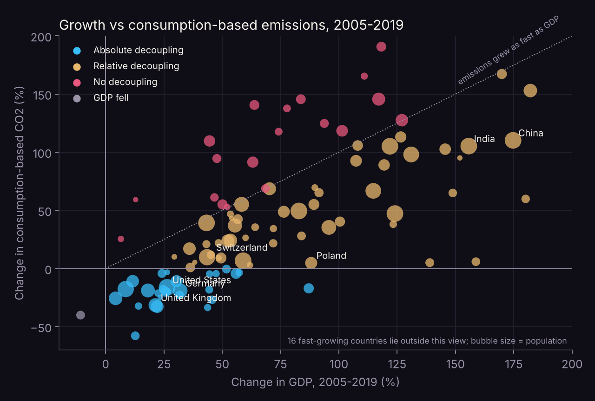
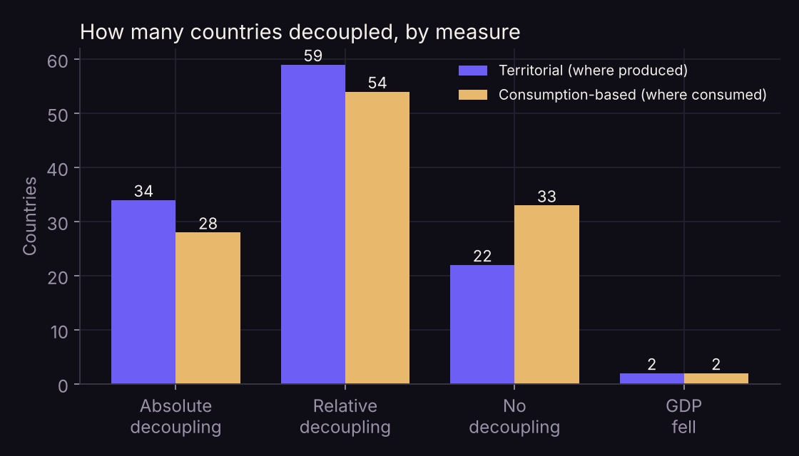
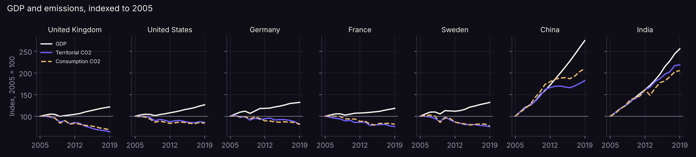

# Can countries grow richer while cutting emissions?

An independent data analysis by Suwaasha Murugaperumal.

## Research question

Between 2005 and 2019, which countries grew their economies while **reducing** CO₂ emissions (absolute decoupling), and does that still hold once emissions embedded in imported goods are counted?

Standard *territorial* figures count emissions where goods are produced, so a country can look greener by importing what it used to make. *Consumption-based* figures assign those emissions to the country that consumes the goods.

## Data

[Our World in Data CO₂ dataset](https://github.com/owid/co2-data): emissions from the Global Carbon Project, and GDP from the Maddison Project Database, adjusted for inflation and price differences. The notebook downloads it directly.

**Scope:** 117 countries with at least 1 million people and complete GDP, territorial and consumption data for 2005 and 2019. Together they produce 97% of the world's territorial CO₂. The window starts when the Kyoto Protocol came into force and ends before COVID-19 distorted 2020.

## Method

Each country is classified on both measures:
- **Absolute decoupling:** GDP up, emissions down.
- **Relative decoupling:** both up, emissions slower.
- **No decoupling:** emissions grew at least as fast as GDP.

## Findings



1. **26 countries achieved absolute decoupling on both measures.** They include the UK (GDP +21%, consumption CO₂ −32%), Germany, France, Sweden, the US (GDP +26%, consumption CO₂ −16%) and Japan. Romania stands out: GDP +87% with consumption CO₂ −17%.
2. **Counting imports shrinks the list from 34 to 28.** Eight countries decoupled on territorial figures only, and their consumption emissions actually rose. These include Switzerland (territorial −20%, consumption +12%), Poland, Hong Kong and Lithuania. Two countries, Canada and Taiwan, decoupled only on the consumption measure.
3. **Decoupling is overwhelmingly a rich-country result.** 62% of the richest third of countries decoupled on consumption figures, compared with 10% of the middle third and none of the lower third.
4. **Most of the world is still in relative decoupling.** 54 countries grew emissions more slowly than GDP, including China (GDP +175%, consumption CO₂ +110%) and India (GDP +156%, consumption CO₂ +105%).





## Limitations

- **Two end points.** An unusual year at either end can move a country between categories.
- **Consumption estimates are modelled** from trade data and are less certain than territorial figures.
- **CO₂ only.** Fossil fuels and industry; other greenhouse gases and land use are excluded.
- **Coverage.** Only about 120 countries have consumption estimates, so many low-income countries are missing.
- **Decoupling is not enough on its own.** Emissions can fall while still falling too slowly for climate targets.

Per-country results are in `figures/country_results.csv`.

## Run it

```bash
pip install pandas numpy scipy statsmodels matplotlib jupyter
jupyter notebook co2_decoupling.ipynb
```

Python · pandas · SciPy · Matplotlib
