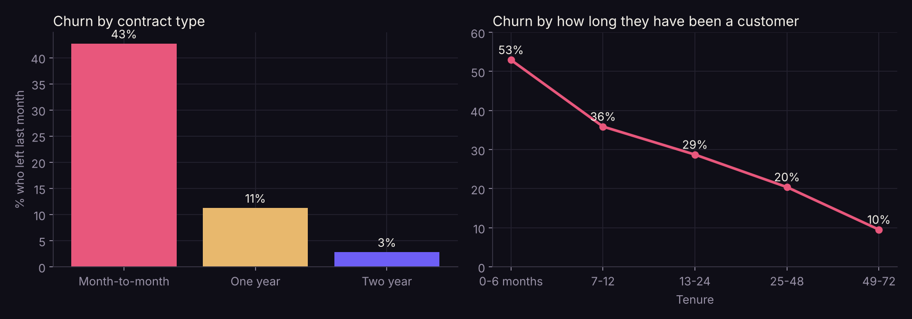
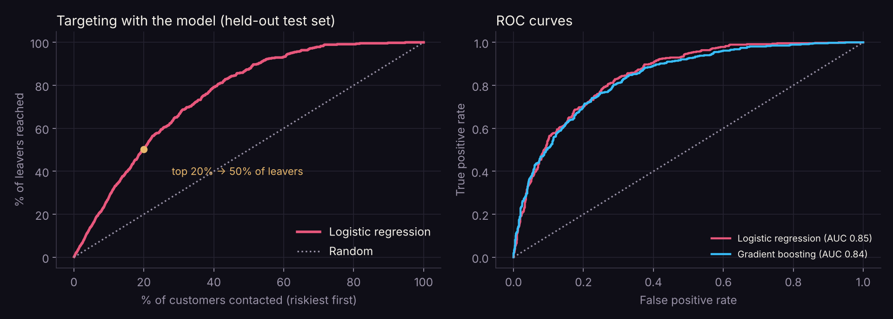
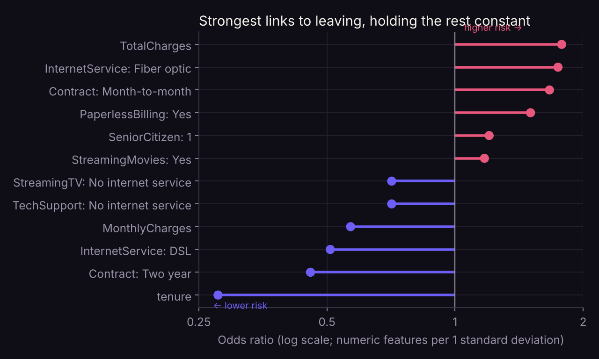

# Which customers leave, and how well can a model spot them in time?

An independent data analysis and machine-learning project by Suwaasha Murugaperumal.

## Research question

For a telecom company, which customer characteristics are most strongly linked to leaving (churn)? When in the customer relationship is the risk highest? And how much better than chance can a simple, explainable model target customers for retention offers?

## Data

[IBM Telco Customer Churn](https://github.com/IBM/telco-customer-churn-on-icp4d), also widely used on Kaggle. It covers 7,043 customers of a fictional California telecom provider: services, contract, billing, tenure and whether they left in the last month. IBM built it as a **sample dataset**, so it is realistic but not real company data. `Telco-Customer-Churn.csv` is included here.

**Cleaning:** 11 customers had a blank total charge. All 11 had a tenure of zero months, so they hadn't been billed yet, and their total was set to 0.

## Method

- Churn rates by contract, tenure, internet service, payment method and support.
- Logistic regression and gradient boosting, compared with 5-fold cross-validation on the training data. A 25% stratified test set was used once, at the end.
- Evaluation: ROC-AUC, precision–recall AUC, calibration, and a targeting curve showing how many leavers you reach by contacting the riskiest customers first.

## Findings



1. **Contract type is the clearest signal.** 43% of month-to-month customers left in the month, compared with 11% on one-year contracts and 3% on two-year contracts.
2. **Risk is highest early.** 53% of customers in their first six months left, falling to 10% after four years. New month-to-month customers are the riskiest group of all (55%).
3. **Other red flags:** fibre-optic internet (42% churn compared with 19% on DSL), paying by electronic check (45%), no tech support (42%) and being a senior citizen (42% compared with 24%).
4. **The simple model is as good as the complex one.** Logistic regression scored a test ROC-AUC of 0.85, against 0.84 for gradient boosting. It is also well calibrated: predicted churn rates match actual rates across risk deciles.
5. **It's useful for targeting.** Contacting the riskiest 20% of customers reaches 50% of those who leave (2.5× random). The riskiest 10% reaches 28% (2.8×).





The most stable drivers in the model are short tenure, month-to-month contracts and fibre-optic service. Tenure, monthly charges and total charges overlap heavily, so their individual odds ratios should be read together rather than one by one.

## Limitations

- **Sample data**, so the patterns may be cleaner than real customer data.
- **One month of churn**, observed once. It shows who left, not when or why.
- **Association, not cause.** Moving customers onto longer contracts won't necessarily stop them leaving.
- **Correlated features**, as noted above.

## Run it

```bash
pip install pandas numpy scipy statsmodels scikit-learn matplotlib jupyter
jupyter notebook telco_churn.ipynb
```

Python · pandas · scikit-learn · SciPy · Matplotlib
